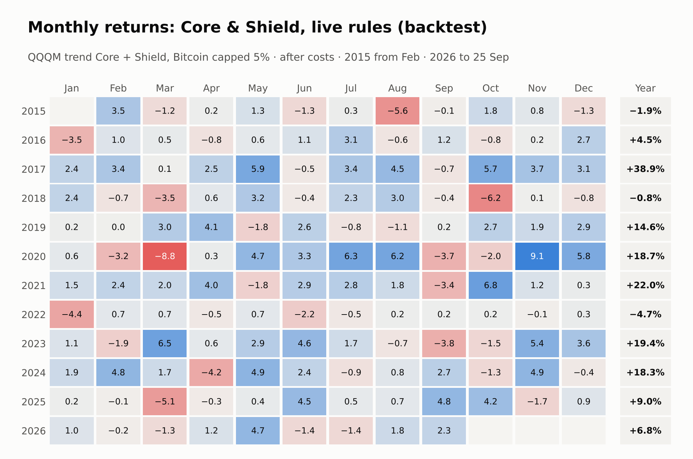
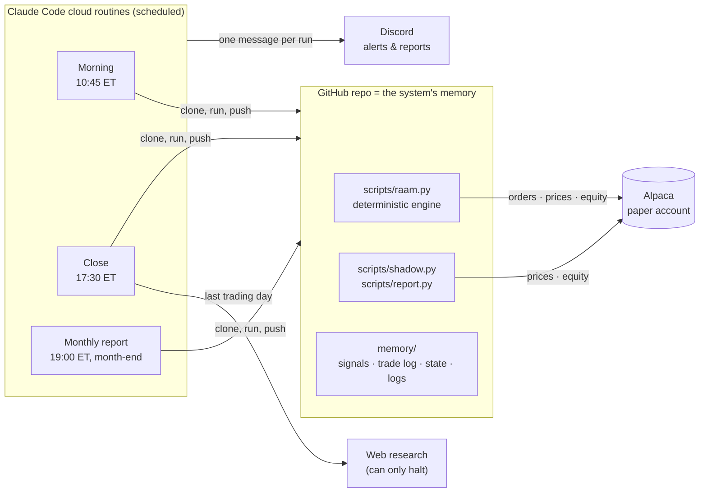

<div align="center">

# Core & Shield

**A rules-based portfolio that aims for most of the stock market's growth with much smaller losses, run by an AI operator on a paper brokerage account.**


**[The idea](#the-idea-in-one-minute)** · **[Results](#results-vs-6040-and-spy)** · **[How it works](#how-it-works)** · **[Is it robust?](#is-it-robust)** · **[Risks](#risks-and-limitations)** · **[How it runs](#how-it-runs)** · **[Docs](#documentation)**

<table>
<tr>
<td align="center" width="25%"><h2>11.8%</h2>return per year<br><sub>60/40: 9.2% · SPY: 14.1%</sub></td>
<td align="center" width="25%"><h2>−11.7%</h2>worst drop<br><sub>60/40: −19.2% · SPY: −23.3%</sub></td>
<td align="center" width="25%"><h2>1.00</h2>Sharpe ratio<br><sub>60/40: 0.73 · SPY: 0.81</sub></td>
<td align="center" width="25%"><h2>4 months</h2>to recover the worst drop<br><sub>60/40: 16 · SPY: 15</sub></td>
</tr>
</table>

<sub>Backtest Feb 2015 – Sep 2026, after trading costs, of the current rules (live from 2 Nov 2026). Sharpe is measured against T-bills.</sub>

</div>


> [!IMPORTANT]
> This is a research project on an Alpaca **paper** (simulated money) account. Backtest results are hypothetical, were built with hindsight, and include simulated Bitcoin prices before 2024. Past performance does not predict future results. **Not investment advice.**

---

## The idea in one minute

- **Half the money grows.** The **Core** (50%) holds the Nasdaq-100 (QQQM). It steps into T-bills when the index falls below its 10-month average, which sidesteps long bear markets.
- **Half the money defends.** The **Shield** (50%) holds the 5 strongest of 12 different ETFs: stocks, bonds, property, commodities and Bitcoin (capped at 5%). When nothing is rising, it holds T-bills.
- **Once a month, no opinions.** A script makes every decision from prices alone. An AI (Claude) runs the routine, logs everything and can stop trading if something looks wrong, but it never picks investments.

**The result, in short:**
- **vs 60/40:** more return (+2.6% a year) with about the same volatility and much smaller drops.
- **vs SPY:** less return (−2.3% a year), but about half the worst drop and a much smoother ride.

---

## Results vs 60/40 and SPY

**Backtest, Feb 2015 – Sep 2026 (140 months), after trading costs.**
- **60/40** = 60% SPY + 40% AGG (US bonds), rebalanced monthly. It is the classic balanced portfolio.
- **SPY** = the S&P 500, 100% stocks.

| | **Core & Shield** | 60/40 | SPY |
|---|---:|---:|---:|
| Return per year | **11.8%** | 9.2% | 14.1% |
| $100,000 grew to | **$367k** | $278k | $468k |
| Volatility (how much it swings) | **9.7%** | 10.0% | 15.6% |
| Worst drop from a peak | **−11.7%** | −19.2% | −23.3% |
| Months to recover from it | **4** | 16 | 15 |
| Worst calendar year | **−4.7%** (2022) | −15.2% (2022) | −18.0% (2022) |
| Best calendar year | **+38.9%** (2017) | +23.7% (2019) | +34.0% (2019) |
| Share of SPY's **losses** in SPY's down months | **46%** | 65% | 100% |
| Share of SPY's **gains** in SPY's up months | **63%** | 64% | 100% |
| Sharpe ratio (return per unit of risk, vs T-bills) | **1.00** | 0.73 | 0.81 |
| Sortino ratio (same, counting only bad volatility) | **1.75** | 1.11 | 1.24 |
| Calmar ratio (return ÷ worst drop) | **1.01** | 0.48 | 0.61 |
| Beta to SPY (how much it moves with the market) | **0.44** | 0.63 | 1.00 |


**What the table says:**
- **Against 60/40 it wins on almost everything.** It earns more, swings about the same, and its worst drop was 39% smaller. It captured about the same share of SPY's rising months as 60/40 (63% vs 64%), but a much smaller share of its falling months (46% vs 65%).
- **Against SPY it trades return for safety.** SPY made more money ($468k vs $367k), but it fell twice as far at its worst and took almost 4× as long to recover. Per unit of risk, Core & Shield did better on every ratio.


**Year by year** (11 full years, 2015–2025):
- **Ahead of 60/40 in 7 of 11 years**, including the 2022 bear market (−4.7% vs −15.2%).
- **Ahead of SPY in 4 of 11 years**: the two down years (2018, 2022) plus 2017 and 2020. In strong bull years such as 2019, 2021 and 2024, SPY was clearly ahead.
- **Over any 12-month window**, it beat SPY 31% of the time. In the windows where SPY lost money, it beat SPY in **14 of 18**.

### Month by month



Each cell is one month's return in the backtest of the current rules (%, after costs; a month runs from its first trading day's open to the next month's). The right-hand column compounds each year. The worst month was March 2020 (−8.8%), when the circuit breaker moved everything to T-bills; most losing months stay under −2%.

### In a crisis


| Crisis | **Core & Shield** | 60/40 | SPY |
|---|---:|---:|---:|
| 2022 (stocks and bonds fell together) | **−4.7%** | −15.2% | −18.0% |
| Jun 2008 – Jun 2009 (financial crisis, real data, no Bitcoin) | **−0.8%** | −17.7% | −31.8% |
| Simulated: −20% crash in one day | **−13.2%** | −16.2% | −21.1% |
| Simulated: stocks and bonds fall for 6 months | **−5.7%** | −22.3% | −24.7% |
| Simulated: stagflation for 6 months | **−4.9%** | −17.3% | −19.7% |

Slow crises are where the design shines: the trend filter and the Shield move to T-bills. **A sudden one-day crash is its weak spot**, because both signals are monthly and can't react in time.

### Different periods

| | **Core & Shield** | 60/40 | SPY |
|---|---:|---:|---:|
| **2015–2019:** return / Sharpe / worst drop | **10.3%** / 1.11 / −8.8% | 8.7% / 1.01 / −8.4% | 12.5% / 0.90 / −15.3% |
| **2020–2026:** return / Sharpe / worst drop | **12.9%** / 0.94 / −11.7% | 9.5% / 0.61 / −19.2% | 15.4% / 0.76 / −23.3% |
| **2008–2026 without Bitcoin:** return / Sharpe / worst drop | **8.8%** / 0.85 / −12.3% | 8.5% / 0.72 / −30.2% | 12.0% / 0.70 / −47.2% |

The pattern holds in each period: behind SPY on return, the best Sharpe of the three, and a far smaller worst drop than SPY. In the calm 2015–19 market its worst drop was about the same as 60/40's. Even over 2008–2026 with no Bitcoin at all, its worst drop was −12.3% against SPY's −47.2%.

<sub>Sources: [readme_metrics.json](backtest/results/readme_metrics.json) (built by `docs/readme_metrics.py`) and [STRESS.md](backtest/results/STRESS.md). T-bills returned 2.0% a year over the main window.</sub>

---

## How it works

**Portfolio = Core (50%) + Shield (50%)**, decided after the close on the last trading day of each month and traded the next morning.

| Half | Holds | Rule |
|---|---|---|
| **Core**, 50% | QQQM (Nasdaq-100), or T-bills (SGOV) | Hold QQQM while its month-end price is above its average of the last 10 month-ends; otherwise hold T-bills |
| **Shield**, 50% | 5 of 12 ETFs, 10% each, or T-bills | Rank the 12 every month and keep the best 5; any pick that is doing worse than T-bills is swapped for T-bills |

**The Shield's 12 candidates:**

| Type | ETFs |
|---|---|
| US stocks | VV (large), IJH (mid), IJR (small) |
| International stocks | EFA (developed), EEM (emerging) |
| Real estate | RWR |
| Commodities | DBC, VAW (materials) |
| Bonds | AGG (US), SCHP (US inflation-protected), IGOV (international) |
| Crypto | BTC (Grayscale Bitcoin Mini Trust), **never more than 5% of the portfolio** |

**How the Shield ranks them.** Each ETF is scored on three things, from prices only:
1. **Momentum:** how much it rose over the last 4 months. Higher is better.
2. **Volatility:** how much it swings. Calmer is better.
3. **Correlation:** how much it moves with the others. Different is better, because that is real diversification.

The 5 with the best average rank are held. This comes from Giordano's *Ranked Asset Allocation Model* (2018).

Where a cheaper fund gives the same exposure, the bot holds the cheaper one: QQQM over QQQ, SGOV over BIL, SCHP over TIP, BTC over IBIT.

<details>
<summary><b>A real month, step by step (the first live month, October 2026)</b></summary>

These are the actual outputs from the 30 Sep 2026 signal and the 1 Oct 2026 trades. That month still used the previous Core (a fixed 30% SPY + 20% AGG); the QQQM Core starts with the 2 Nov 2026 rebalance.

**1 · Research gate.** Claude checks every fund for closures, mergers, ticker changes and trading halts. A real problem stops the signal; market news is only logged.


**2 · Signal.** Ranks the 12 candidates and keeps the best 5. In September three of the five were weaker than T-bills, so their slots went to T-bills.


**3 · Portfolio.** Adds the Core, then applies the 5% Bitcoin cap.


**4 · Execution.** Orders go to Alpaca at about 10:45 ET on the first trading day of the month: sells first, then buys. Every fill is logged with its slippage.


**5 · Oversight.** Each month is scored against a pre-registered evaluation plan, and every run posts one line to Discord.


</details>

---

## Is it robust?

A good backtest can be luck. These checks test that:

| Question | Answer |
|---|---|
| **Is the ranking skill or luck?** | It beats **98–99%** of 1,000 portfolios whose Shield picks 5 ETFs at random each month (same rules otherwise), in both 2015–26 and 2008–26. |
| **Is it a lucky choice of settings?** | Changing the lookbacks, number of holdings or factor weights gives a Sharpe between 1.08 and 1.28 (rf = 0). All **13 of 13** variants still beat 60/40. |
| **Does it survive trading costs?** | It stays ahead of 60/40 up to about 25 bps per trade (the backtest assumes 5 bps). |
| **What if trades are late?** | Trading 5 days after the signal costs a little but stays ahead of 60/40. |
| **What about the future?** | In 5,000 simulated 10-year paths built from reshuffled history, it had a higher Sharpe than 60/40 in **88%** and a smaller worst drop in **80%**. |
| **How much is Bitcoin?** | Without Bitcoin it returns 8.9% a year (vs 11.8%) with a similar worst drop. Bitcoin helps but isn't the whole story. |


<sub>Details: [ROBUSTNESS.md](backtest/results/ROBUSTNESS.md) · [STRESS.md](backtest/results/STRESS.md) · [backtest report](backtest/results/REPORT.md)</sub>

---

## Risks and limitations

- **It will trail SPY in strong bull markets.** That is the price of the defence. Expect years like 2019 (+15% vs SPY +34%).
- **One-day crashes.** In a simulated −20% day it lost about 13%, because the Core is fully invested until the monthly check.
- **A bet on the Nasdaq-100.** The Core was chosen knowing the Nasdaq-100 led 2010–26. In the 2000–02 dot-com crash, the trend-filtered Nasdaq-100 still fell about 36% before stepping aside (roughly −18% for this portfolio).
- **Whipsaw.** In choppy markets the trend filter can sell low and buy back higher.
- **Hindsight.** Several design choices were made after seeing this data, so treat the backtest as optimistic. With about 11 years of data, a Sharpe ratio is only accurate to about ±0.3. **The live paper record is the real test.**
- **Not modelled:** taxes (it trades monthly, so it suits tax-advantaged accounts) and real-money market impact.

---

## How it runs

| | |
|---|---|
| **Account** | Alpaca paper account, $100,000, live since 1 Oct 2026. The current design takes over at the **2 Nov 2026** rebalance |
| **Daily** | Health check: value, drawdown, drift and circuit breaker. One Discord message |
| **Monthly** | Research check → signal → trades → one-page PDF report → review against the evaluation plan |
| **Safety** | A circuit breaker moves everything to T-bills after a −20% drawdown or a −5% day. Bad or stale prices stop the signal. Order-size limits apply. Live trading needs two explicit switches |
| **AI's role** | Claude runs the routines and writes the logs, and may **halt**. It never changes targets, picks, timing or rules. All maths and orders live in one deterministic script (`scripts/raam.py`) |
| **Evaluation** | Pass/fail criteria were written before the first trade ([EVALUATION-PLAN.md](memory/EVALUATION-PLAN.md)), with checkpoints in Dec 2026 and Feb, May and Nov 2027. Alternatives, including the previous 60/40-Core design, are tracked without trading in [SHADOW-LOG.md](memory/SHADOW-LOG.md) |
| **Track record** | [reports/](reports/) · [TRADE-LOG.md](memory/TRADE-LOG.md) · [SIGNAL-LOG.md](memory/SIGNAL-LOG.md) · [MONTHLY-REVIEW.md](memory/MONTHLY-REVIEW.md) |

<details>
<summary><b>System architecture</b></summary>



| Routine | Schedule (cron in UTC) | Does |
|---|---|---|
| **Morning** | Weekdays 10:45 EDT / 09:45 EST | Rebalances on the first trading day of the month, or if the breaker tripped. Otherwise does nothing. |
| **Close** | Weekdays 17:30 EDT / 16:30 EST | Daily health; month-end research → signal → shadow variants; first-day monthly review. |
| **Monthly report** | 19:00 EDT / 18:00 EST, days 28–31 | One-page PDF (account vs 60/40) on the last trading day, posted to Discord. |

**Engineering:**
- One deterministic engine: the same data always gives the same targets. The backtest calls the same code that trades.
- Every command prints a single JSON object with `ok` / `noop` / `halt` / `error`.
- Dry-run modes everywhere. Rebalances are idempotent: a month can't be traded twice.
- **83 tests** with no network, including fault drills for broker errors, partial fills and bad data.

</details>

<details>
<summary><b>Methodology and assumptions</b></summary>

| Item | Assumption |
|---|---|
| Data | Yahoo Finance daily prices, adjusted for splits and dividends |
| Window | Feb 2015 – Sep 2026 (140 monthly rebalances). Also Mar 2008 – Sep 2026 without Bitcoin (IGOV extended with BWX before 2009) |
| Execution | Signal at the month-end close, fill at the next session's open, held to the next rebalance |
| Costs | 5 bps per side on turnover (about 0.25% a year). Fund fees are inside the ETF prices. No management fee, financing or taxes |
| Turnover | About 21% of the portfolio changes each month |
| Funds younger than the window | Bitcoin: BTC-USD minus BTC's 0.15% fee before its July 2024 launch. QQQM before Oct 2020 = QQQ; SGOV before May 2020 = BIL; SCHP before Aug 2010 = TIP (same exposures, fee advantage ignored) |
| Ratios | Sharpe and Sortino use returns above T-bills (2.0% a year over the window). Calmar = annual return ÷ worst month-end drawdown over the whole window |
| Known biases | Dropping the paper's trend factor, the 50/50 split, adding Bitcoin and choosing the Nasdaq-100 were all decided after seeing this data. There is no clean out-of-sample period |

</details>

<details>
<summary><b>Why QQQM for the Core?</b></summary>

Every Core was tested with the same Shield, rules and costs. Higher Calmar (return ÷ worst drop) is better.

| Core | Calmar 2015–26 | Calmar 2008–26 (no Bitcoin) | Return 2015–26 |
|---|---:|---:|---:|
| **QQQM + 10-month trend filter (current)** | **1.01** | **0.72** | **11.8%** |
| Previous: fixed 60/40 (30% SPY + 20% AGG) | 0.84 | 0.34 | 9.2% |
| SPY, fixed | 0.82 | 0.26 | 11.8% |
| SPY + trend filter | 0.61 | 0.50 | 8.3% |
| VTI + trend filter | 0.72 | 0.50 | 8.8% |
| Ranked growth Core (sector rotation) | 0.89 | 0.60 | 8.7% |

The rows below the first two were tested before the switch to lower-fee funds, which moved the current row by 0.01. **The hindsight check:** on the Core alone from 1999, the trend-filtered Nasdaq-100 fell 36.5% in the dot-com crash (trend-filtered S&P 500: −11.0%). Over 1999–2026 the S&P 500 version had the better Calmar (0.33 vs 0.26). The Nasdaq-100's lead is a 2010s-era result.

</details>

<details>
<summary><b>Repository guide</b></summary>

| Path | Purpose |
|---|---|
| `CLAUDE.md` | Operating instructions for the AI operator (rules, safety, standard procedure) |
| `config/raam.json` | Strategy parameters and guardrail thresholds |
| `config/shadow.json` | Pre-registered shadow variants (tracked, never traded) |
| `scripts/raam.py` | Deterministic engine: calendar, signal, rebalance, health, review, pre-flight |
| `scripts/shadow.py` | Shadow tracking of strategy variants |
| `scripts/report.py` | One-page monthly PDF report |
| `scripts/alpaca.sh`, `scripts/discord.sh` | Broker and notification helpers |
| `.claude/commands/` | Operator commands: `/signal` `/rebalance` `/health` `/monthly-review` `/report` `/research` `/portfolio` `/trade` |
| `routines/` | Paste-ready prompts for the cloud routines |
| `memory/` | Rules, evaluation plan, backtest summary, logs, signals, state |
| `backtest/` | Backtest (`backtest.py`), stress tests (`stress.py`), robustness tests (`robustness.py`) and results |
| `docs/` | Strategy handbook PDF, README figures and image builder |
| `reports/` | Monthly PDF reports |
| `tests/` | pytest suite (engine, commands, faults, report, shadow) |

</details>

<details>
<summary><b>Quickstart (local)</b></summary>

```bash
python -m pip install -r requirements.txt
cp env.template .env                                # Alpaca paper keys, Discord webhook
python -m pytest -q                                  # 83 tests, no network
python scripts/raam.py calendar
python scripts/raam.py signal --force --dry-run      # today's ranks, nothing saved
python scripts/raam.py rebalance --force --dry-run   # the orders it would place
python backtest/backtest.py                          # rebuild the backtest report
python docs/readme_metrics.py                        # rebuild the README's figures
python docs/build_readme_assets.py                   # rebuild the README images
```

</details>

<details>
<summary><b>Cloud routine setup</b></summary>

1. **Cloud environment** (claude.ai/code → environments):
   - **Environment variables:** everything in `env.template`, with real values. Keep `PAPER_TRADING=true`. Routines read keys only from here; the scripts never read `.env` in the cloud.
   - **Network:** custom. Allow `paper-api.alpaca.markets`, `data.alpaca.markets` and `discord.com`, plus default package managers.
   - **Setup script:** `python3 -m pip install -r requirements.txt`
2. **Routines:**
   - repo `mark-musumeci/RAAM-Trading-Project`;
   - the environment above;
   - no connectors;
   - prompts and crons from [routines/](routines/).
3. **First runs:** use *Run now* with `dry_run` and read the transcript. A green status only means it didn't crash.

</details>

---

## Documentation

- **[Strategy handbook (PDF)](docs/Core-and-Shield-Strategy.pdf):** the full strategy in 13 pages.
- [Trading rules](memory/TRADING-STRATEGY.md) · [Evaluation plan](memory/EVALUATION-PLAN.md) · [Backtest summary](memory/BACKTEST-SUMMARY.md)
- Results: [backtest report](backtest/results/REPORT.md) · [stress tests](backtest/results/STRESS.md) · [robustness](backtest/results/ROBUSTNESS.md)

## References

- Giordano, G. (2018). *Ranked Asset Allocation Model.* Charles H. Dow Award, CMT Association. The origin of the Shield.
- Faber, M. (2007). A quantitative approach to tactical asset allocation. *Journal of Wealth Management.* The 10-month trend filter.
- Moskowitz, T., Ooi, Y. H. & Pedersen, L. H. (2012). Time series momentum. *Journal of Financial Economics.*
- Asness, C., Moskowitz, T. & Pedersen, L. H. (2013). Value and momentum everywhere. *Journal of Finance.*
- Hurst, B., Ooi, Y. H. & Pedersen, L. H. (2017). A century of evidence on trend-following investing. *Journal of Portfolio Management.*
- Frazzini, A. & Pedersen, L. H. (2014). Betting against beta. *Journal of Financial Economics.*
- Israelsen, C. (2010). *7Twelve: A Diversified Investment Portfolio with a Plan.* Wiley.

<sub>Paper-trading research project. All backtested results are hypothetical, and simulated performance has inherent limitations. Nothing here is investment, financial or trading advice.</sub>
