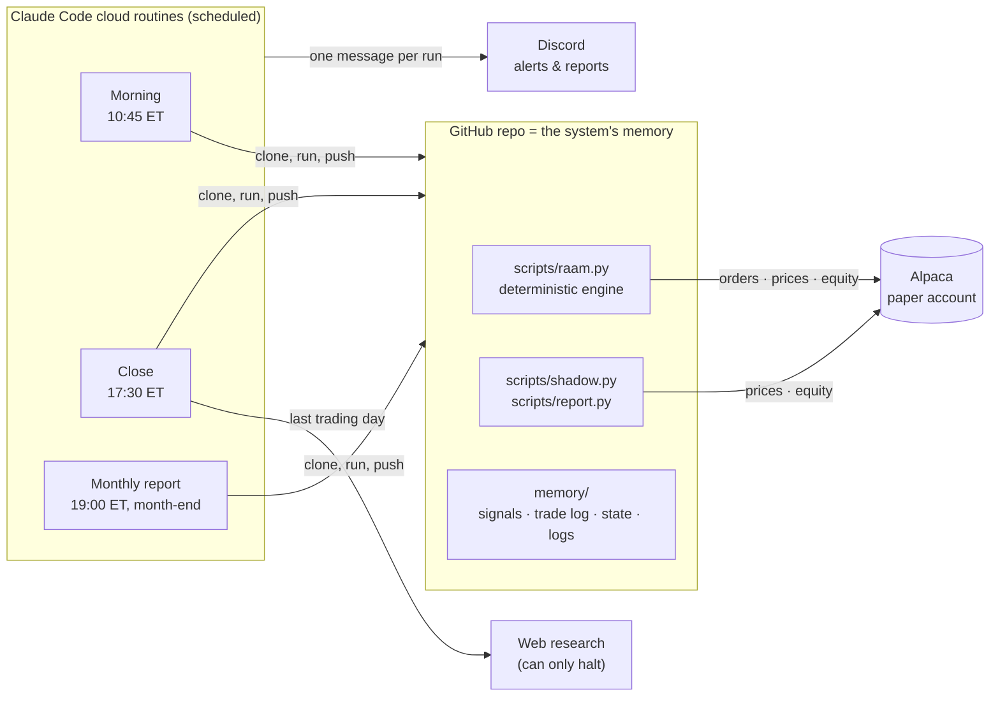

<div align="center">

# Core & Shield

**A rules-based growth-plus-defence strategy, run end-to-end by an AI operator on a paper brokerage account.**


**[Summary](#executive-summary)** · **[How it works](#how-it-works)** · **[A real month](#a-real-month-step-by-step)** · **[Evidence](#evidence)** · **[Risk & governance](#risk-management-and-governance)** · **[Architecture](#system-architecture)** · **[Docs](#documentation)**

<table>
<tr>
<td align="center" width="25%"><h2>11.9%</h2>return per year<br><sub>60/40: 9.2%</sub></td>
<td align="center" width="25%"><h2>1.01</h2>Sharpe vs T-bills<br><sub>60/40: 0.73</sub></td>
<td align="center" width="25%"><h2>1.02</h2>Calmar ratio<br><sub>60/40: 0.48</sub></td>
<td align="center" width="25%"><h2>−11.7%</h2>worst month-end drop<br><sub>60/40: −19.2%</sub></td>
</tr>
</table>

<sub>Backtest Feb 2015 – Sep 2026, after costs, of the rules live from 2 Nov 2026. At rf = 0 the Sharpe ratios are 1.21 vs 0.93. Without Bitcoin: 9.0%/yr, Sharpe vs T-bills 0.79. 2008–2026 without Bitcoin: 8.8%/yr vs 8.5%, Calmar 0.72 vs 0.28. The Core's Nasdaq-100 choice was made knowing it led 2010–26: see [Limitations](#limitations).</sub>

</div>


> [!IMPORTANT]
> Research project on an Alpaca **paper** account. Backtested figures are hypothetical, were built with the benefit of hindsight, and include a simulated Bitcoin history before January 2024. Past performance does not predict future results. **Not investment advice.**

---

## Executive summary

| | |
|---|---|
| **What** | Half the portfolio is a growth **Core**: QQQM (Nasdaq-100), held only while its month-end price is above its 10-month average, otherwise T-bills. The other half (**Shield**) holds the 5 strongest of 12 diversified ETFs, including spot Bitcoin capped at 5%, and moves to T-bills when nothing is trending. |
| **Objective** | Beat a 60/40 on return with smaller drawdowns: the Core supplies growth, the Shield and the Core's trend filter supply the defence. |
| **Edge, tested** | Calmar 1.02 vs 0.48 for 60/40 and 0.84 for the previous design. With the Shield's ranking, the strategy beats **99%** of 1,000 random-pick portfolios on Sharpe in both 2015–26 and 2008–26. |
| **Governance** | Deterministic engine, pre-registered evaluation plan, shadow tracking of alternatives (including the previous design), full change log. The AI operates; it never decides. |
| **Status** | Live on Alpaca paper since **1 Oct 2026**. The current Core went live at the **2 Nov 2026** rebalance; the 12-month evaluation restarted then, with the verdict due **Nov 2027**. |

**Key statistics.** Backtest Feb 2015 – Sep 2026 (140 months): 5 bps per trade, next-open fills. T-bills (BIL) returned 2.0%/yr over the window.

| | **Live rules** | Live without Bitcoin | Previous (60/40 Core) | 60/40 | SPY |
|---|---:|---:|---:|---:|---:|
| Return per year | **11.9%** | 9.0% | 9.3% | 9.2% | 14.1% |
| Volatility | 9.7% | 9.0% | 7.8% | 10.0% | 15.6% |
| Sharpe ratio vs T-bills | **1.01** | 0.79 | 0.93 | 0.73 | 0.81 |
| Sharpe ratio, rf = 0 | 1.21 | 1.01 | 1.18 | 0.93 | 0.93 |
| Sortino ratio vs T-bills | **1.77** | 1.28 | 1.58 | 1.11 | 1.24 |
| Calmar ratio | **1.02** | 0.74 | 0.84 | 0.48 | 0.61 |
| Worst month-end drawdown | −11.7% | −12.2% | −11.1% | −19.2% | −23.3% |
| Worst daily drawdown | −15.4% | −16.1% | −14.1% | — | −33.7% |
| Months to recover the worst drawdown | **4** | 4 | 16 | 16 | 15 |
| 2022 | **−4.9%** | −3.8% | −8.8% | −15.2% | −18.0% |
| Beta to 60/40 | 0.68 | 0.64 | 0.69 | 1.00 | — |

Over a longer, harder window **without Bitcoin** (Mar 2008 – Sep 2026, 223 months), the live rules returned **8.8%/yr** against 60/40's 8.5% and the previous design's 6.6%. Against T-bills the Sharpe was **0.85 vs 0.72**, Sortino **1.39 vs 1.06** and Calmar **0.72 vs 0.28**, with a worst month-end drawdown of **−12.2% vs −30.2%**.

---

## Investment thesis

1. **The problem.** A 60/40 is the default balanced portfolio, but its losses arrive together. Stocks and bonds fell at the same time in 2022 (−15.2%), and the 2008–09 drawdown reached −30%.
2. **The trade-off.** Growth assets compound but suffer deep drawdowns. Tactical trend-following models sidestep slow bear markets but lag in bull markets.
3. **The design.** Give each half one job:
   - The **Core** is pure growth (the Nasdaq-100), with a simple, well-studied exit: it steps into T-bills when the index falls below its 10-month average.
   - The **Shield** is a rotation engine that holds what is trending, calm and diversifying, and retreats to T-bills when trends break.
   - Because the Shield already defends, the Core doesn't need bonds.
4. **Why the signals should persist.** They rest on some of the best-documented effects in finance:
   - time-series and cross-sectional **momentum** across asset classes, over a century of data;
   - **trend filters** on equity indices (Faber, 2007);
   - the **low-volatility** effect and **diversification** across low-correlation assets.

   See the references below.
5. **Who it is for.** Investors who want more than a 60/40's return but are judged on drawdowns and risk-adjusted return.

**Not designed to:**
- avoid a one-day crash (both signals are monthly);
- diversify away from US tech (the Core is the Nasdaq-100 when it's on);
- be a Bitcoin strategy (one Shield candidate of twelve, capped at 5%).

---

## How it works

**Portfolio = Core + 0.5 × Shield**, rebalanced once a month.

| Half | Weight | Holdings | Rule |
|---|---|---|---|
| **Core** | 50% | QQQM, or T-bills (BIL) | Held while QQQM's month-end close is above the average of its last 10 month-end closes; otherwise the Core's 50% sits in BIL. Checked every month |
| **Shield** | 50% | 5 slots × 10%, chosen from 12 candidates | Re-ranked every month; failed slots go to BIL (T-bills) |

**Shield candidates** (the 7Twelve multi-asset set plus spot Bitcoin):

| Asset class | ETFs |
|---|---|
| US equities | VV, IJH, IJR |
| International equities | EFA, EEM |
| Real estate | RWR |
| Commodities and resources | DBC, VAW |
| US bonds and inflation-protected | AGG, TIP |
| International government bonds | IGOV |
| Crypto | IBIT, **capped at 5% of the portfolio** |
| Cash (not ranked) | BIL |

**The monthly decision** is computed after the close on the last trading day, and traded at the next morning's session (~10:45 ET):

| Factor | Measure | Best rank goes to |
|---|---|---|
| Momentum | 84-trading-day return | highest |
| Volatility | EWMA (λ = 0.94), annualised, 10-day smoothed | lowest |
| Correlation | average 84-day correlation with the other 11 | lowest |

`Score = ⅓·Rank(M) + ⅓·Rank(V) + ⅓·Rank(C)`. The 5 lowest scores are selected. A selected ETF keeps its 10% slot only if its momentum beats T-bill (BIL) momentum; otherwise the slot goes to BIL. Full rules: [memory/TRADING-STRATEGY.md](memory/TRADING-STRATEGY.md).

---

## A real month, step by step

Each stage has one job and one owner. These are the actual outputs from the first live month: the 30 Sep 2026 signal and the 1 Oct 2026 trades. That month still used the **previous 60/40 Core**; from November the Core is QQQM with its trend filter, and every signal records the filter's state.

### 1 · Research gate
- Claude scans all 14 funds for closures, mergers, ticker or index changes and halts, plus custody and regulatory risks for IBIT.
- A structural flag **stops** the signal and raises a ⚠️ alert. Market news is logged as context and never changes a pick.


### 2 · Signal engine
- Ranks the 12 candidates on momentum, volatility and correlation, and keeps the best 5.
- Each pick must then beat T-bill momentum. In September, three of the five did not, so their slots went to T-bills: the model turned defensive as designed.


### 3 · Portfolio construction
- Adds the Core to the Shield's picks, then applies the caps. (In October that was the previous fixed 60/40 Core.)
- IBIT won a full 10% slot, so the 5% cap moved half of it to T-bills.


### 4 · Execution
- After the risk checks, orders go to Alpaca at about 10:45 ET on the first trading day: sells first, then buys.
- Every fill is logged with its slippage against the planned price.


### 5 · Oversight
- Each month is scored against the pre-registered evaluation plan, and every run posts one line to Discord.
- The first review, covering the 30 Sep signal and the 1 Oct rebalance, passed every operations check (O1–O8).


---

## Methodology and assumptions

| Item | Assumption |
|---|---|
| Engine | The backtest calls the live `compute_signal()`: the code that trades is the code that was tested |
| Data | Yahoo Finance daily prices, adjusted for splits and dividends |
| Window | Feb 2015 – Sep 2026, 140 monthly rebalances. Also Mar 2008 – Sep 2026 without Bitcoin (IGOV extended with BWX before 2009) |
| Execution | Signal at the month-end close; fill at the next session's open; held to the next rebalance |
| Costs | 5 bps per side on turnover. No management fee, financing or taxes |
| Bitcoin before 2024 | BTC-USD on US trading days, minus IBIT's 0.25% fee, spliced into real IBIT from its January 2024 launch |
| QQQM before Oct 2020 | QQQ (the same Nasdaq-100 index), spliced into real QQQM at launch; QQQM's 0.05%/yr lower fee is ignored |
| Circuit breaker | Simulated on the daily path |
| Benchmarks | 60/40 = 60% SPY + 40% AGG, rebalanced monthly; SPY total return |
| Sharpe ratio | Shown both against T-bills (BIL, 2.0%/yr over the window) and at rf = 0 |
| Sortino ratio | Annual return above T-bills ÷ annualised downside deviation (months below T-bills only) |
| Calmar ratio | Annual return ÷ worst month-end drawdown over the whole window (not the usual 36-month window) |
| Known biases | Several design choices (dropping the trend factor, the 50/50 split, adding Bitcoin, **choosing the Nasdaq-100 for the Core**) were made after seeing this data, so there is no clean out-of-sample period. Treat all backtest figures as optimistic; the live paper record is the real test. |

---

## Evidence

### Backtest


The live rules beat 60/40 by **2.7%/yr** with slightly lower volatility (9.7% vs 10.0%) and a **39% smaller** worst month-end drawdown. They took **72%** of 60/40's losses in 60/40's down months, and recovered from the worst drawdown in 4 months against 16.


- **Ahead in 8 of 12 years**, including 2022 (−4.9% vs −15.2%), when the Core's trend filter moved it into T-bills.
- **Behind in 2015, 2016, 2019 and 2025:** choppy or strongly rising markets where the filter or the Shield's caution cost return.

### Early vs late period

The design choices used the whole 2015–2026 history, so neither half is truly out of sample. Splitting it still shows whether the result depends on one era:

| | 2015–19 Live rules | 2015–19 Previous | 2015–19 60/40 | **2020–26 Live rules** | **2020–26 Previous** | **2020–26 60/40** |
|---|---:|---:|---:|---:|---:|---:|
| Return per year | 10.3% | 9.4% | 8.7% | **13.1%** | **9.2%** | **9.5%** |
| Sharpe vs T-bills | 1.11 | 1.23 | 1.01 | **0.95** | **0.75** | **0.61** |
| Sortino vs T-bills | 1.92 | 2.31 | 1.57 | **1.70** | **1.24** | **0.92** |
| Calmar | 1.17 | 1.32 | 1.04 | **1.12** | **0.83** | **0.49** |
| Worst month-end drawdown | −8.8% | −7.1% | −8.4% | **−11.7%** | **−11.1%** | **−19.2%** |

The new Core's advantage is **concentrated in 2020–26**. In 2015–19 it was slightly worse than the previous design on every risk-adjusted measure. That is the honest shape of the result: a design that did best in the tech-led, trend-friendly 2020s.

Source: [backtest/results/readme_metrics.json](backtest/results/readme_metrics.json), built by `docs/readme_metrics.py`.

### Choosing the Core

Every Core was tested with the same Shield, rules and costs (calmer is better):

| Core | Calmar 2015–26 | Calmar 2008–26 (no Bitcoin) | Return 2015–26 |
|---|---:|---:|---:|
| **QQQM (Nasdaq-100) + 10-month trend filter, live** | **1.02** | **0.72** | **11.9%** |
| Previous: fixed 60/40 (30% SPY + 20% AGG) | 0.84 | 0.35 | 9.3% |
| SPY, fixed | 0.82 | 0.26 | 11.8% |
| SPY + trend filter | 0.61 | 0.50 | 8.3% |
| VTI + trend filter | 0.72 | 0.50 | 8.8% |
| Ranked growth Core (sector rotation) | 0.89 | 0.60 | 8.7% |

**The hindsight check:** on the Core alone from 1999, the trend-filtered Nasdaq-100 fell **−36.5%** in the 2000–02 dot-com crash (S&P 500 with the same filter: −11.0%), and over 1999–2026 the S&P 500 version had the better Calmar (0.33 vs 0.26). The Nasdaq-100's lead is a 2010s-era result.

### Is the ranking skill or luck?


The Shield's ranking was compared with 1,000 portfolios whose Shield holds **5 random candidates** each month, with every other rule identical.

| Test | 2015–26 (with Bitcoin) | 2008–26 (no Bitcoin) |
|---|---:|---:|
| Beats random on Sharpe | **99%** | **99%** |
| Beats random on down-market defence | **99%** | **100%** |
| Beats random on worst daily drop | 99% | 98% |
| Beats random on return | 99% | 73% |
| Shield on its own: beats random on Sharpe | 96% | 94% |

**Which parts matter:**
- *Momentum alone* earns more but defends far worse: 91% of 60/40's down-month losses against 72%, with a −18.9% worst day against −15.4%. The volatility and correlation ranks are what make the Shield defensive.
- *No ranking* (all 12 candidates with the cash test) gets similar returns but worse drawdowns (−18.3% worst day). The ranking adds defence on top of the cash test.

Source: [backtest/results/ROBUSTNESS.md](backtest/results/ROBUSTNESS.md).

### Stress tests


| Question | Finding |
|---|---|
| **Trading costs** | The edge over 60/40 holds to about 25 bps per trade (Sharpe, rf = 0: 1.09 vs ~0.92) and is nearly gone at 50 bps (0.95). |
| **Parameter sensitivity** | **13 of 13** nearby settings (lookbacks 63–126 days, hold 4–6, λ, factor weights ±10 pp) still beat 60/40's Sharpe; the range is 1.12–1.27. It is not a lucky peak. |
| **Late execution** | Filling 2–5 days after the signal costs a little (Sharpe 1.20 → 1.08 at 5 days) but stays ahead of 60/40. |
| **Any single year** | It beat 60/40 on return in **59%** of rolling 12-month windows, and in **all 14** windows where 60/40 lost money. |
| **Monte Carlo** | Across 5,000 bootstrapped 10-year paths: **89%** chance of a higher Sharpe than 60/40, **80%** chance of a smaller worst drawdown. Any single year: 38% chance of trailing 60/40. |
| **Simulated crash day (−20%)** | Average loss −13.2% vs 60/40's −16.2%. **Worse than the previous design (−9.3%)**: the Nasdaq-100 Core is fully exposed until the monthly filter reacts. |
| **Stocks and bonds falling together (6 months)** | −5.7% vs 60/40's −22.3% (previous design −10.3%): the trend filter steps aside. |
| **Stagflation (6 months)** | −4.9% vs −17.3%. |
| **Bitcoin −80% while held** | About −3 pp extra loss, as the 5% cap intends. |

Source: [backtest/results/STRESS.md](backtest/results/STRESS.md).

### Attribution: where the return comes from

| | Beta to 60/40 | Alpha / yr (rf = T-bills) |
|---|---:|---:|
| Live rules | **0.68** | **+4.9%** (t ≈ 2.3) |
| Live rules without Bitcoin | 0.64 | +2.4% (t ≈ 1.3) |
| Previous design (60/40 Core) | 0.69 | +2.2% (t ≈ 2.0) |

Market exposure is about the same as before, but more of the return now comes from the Core's growth and trend timing and less from Bitcoin. Part of the alpha is the Nasdaq-100's strong 2010s, which should not be expected to repeat at the same size.

---

## Risk management and governance

| Control | Rule |
|---|---|
| **Circuit breaker** | −20% from the high-water mark, or −5% in one day, moves the whole portfolio to T-bills. It re-enters automatically at the next monthly rebalance. |
| **Data integrity** | Stale, missing, blank or non-positive prices halt the signal. There is no guessing. |
| **Order checks** | Weights must sum to 100% ± 0.5%; universe tickers only; no single buy above 55% of equity (a full 50% Core buy must fit); buys are scaled to available cash; the market must be open. |
| **Broker failures** | A rejected or partial order, or an API error mid-rebalance, records what filled, halts, and alerts. It is never retried blindly. |
| **Paper lock** | Live trading needs two explicit switches (`PAPER_TRADING=false` and `LIVE_CONFIRM=yes`). |
| **Pre-registered evaluation** | Pass/fail criteria were written *before* the first trade ([EVALUATION-PLAN.md](memory/EVALUATION-PLAN.md)): operations (O1–O8) and behaviour (B1–B5), with a rules-based 12-month verdict. |
| **Shadow tracking** | Pre-registered alternatives are tracked monthly without trading, **including the previous 60/40-Core design**, plus no Bitcoin, 50% SPY Core, 40/10 Core, a Bitcoin satellite and gold as a 13th candidate ([SHADOW-LOG.md](memory/SHADOW-LOG.md)). This shows month by month whether the switch is paying off, without resetting the test. |
| **Change control** | Rules change only by owner decision, with evidence, in a dated change log. |
| **AI boundaries** | Claude runs the routines, writes the logs and may **halt**. It never changes targets, picks, timing or rules. All maths and orders live in one deterministic script. |
| **Secrets** | API keys live only in the cloud environment's variables, never in files, commits or messages. |

---

## Costs, capacity and taxes

| | |
|---|---|
| **Turnover** | About 21% of the portfolio is replaced each month (5.1× a year, two-sided) |
| **Trading cost in the backtest** | 5 bps per side ≈ 0.25% a year. The edge over 60/40 holds to about 25 bps per side |
| **Live slippage, first rebalance** | Value-weighted average about 0 bps (range −10.5 to +6.2 bps across 5 orders) |
| **Capacity** | All holdings are liquid US-listed ETFs; one monthly rebalance. Capacity is not a constraint at personal or small-fund scale |
| **Fund fees** | Inside the ETF prices, so included. No management or advisory fee is modelled |
| **Taxes** | Not modelled. Monthly turnover and trend switches would create short-term gains in a taxable account, so it suits tax-advantaged accounts best |

---

## Live paper trading

| | |
|---|---|
| Account | Alpaca paper, $100,000 starting equity |
| First signal / first trades | 30 Sep 2026 / 1 Oct 2026 (all orders filled, previous 60/40 Core) |
| Current Core | QQQM + 10-month trend filter, from the 2 Nov 2026 rebalance |
| Daily | Health check: equity, drawdown, drift, breaker. One Discord line. |
| Monthly | Signal, rebalance, one-page PDF report, and a review scored against the evaluation plan |
| Where to look | [reports/](reports/) · [memory/SHADOW-LOG.md](memory/SHADOW-LOG.md) · [memory/TRADE-LOG.md](memory/TRADE-LOG.md) · [memory/SIGNAL-LOG.md](memory/SIGNAL-LOG.md) · [memory/MONTHLY-REVIEW.md](memory/MONTHLY-REVIEW.md) |

| Checkpoint | Date | Question |
|---|---|---|
| 1 month | Dec 2026 | Does the new design run correctly? |
| 3 months | Feb 2027 | Is it reliable? |
| 6 months | May 2027 | Does it behave like the backtest? |
| 12 months | Nov 2027 | Is it worth running? |

---

## System architecture



| Routine | Schedule (cron in UTC) | Does |
|---|---|---|
| **Morning** | Weekdays 10:45 EDT / 09:45 EST | Rebalance on the first trading day of the month, or if the breaker tripped. Otherwise does nothing. |
| **Close** | Weekdays 17:30 EDT / 16:30 EST | Daily health; month-end research → signal → shadow variants; first-day monthly review. |
| **Monthly report** | 19:00 EDT / 18:00 EST, days 28–31 | One-page PDF (account vs 60/40) on the last trading day, posted to Discord. |

**Engineering:**
- One deterministic engine: the same data always gives the same targets.
- Every command prints a single JSON object with `ok` / `noop` / `halt` / `error`.
- Dry-run modes everywhere; idempotent rebalances (a month can't be traded twice).
- **80 tests** with no network, including fault drills for broker errors, partial fills and bad data, and the Core trend filter.

---

## Limitations

- **A bet on the Nasdaq-100.** The Core was chosen after seeing the Nasdaq-100 lead 2010–26. In the 2000–02 dot-com crash the trend-filtered index still fell about 36% before stepping aside, roughly an extra −18% on this portfolio. Over 1999–2026, a trend-filtered S&P 500 had the better Calmar.
- **One-day crashes.** In simulated −20% crash days it lost about 13%, more than the previous design (9%), because the Core is fully exposed until the monthly filter reacts. The −5% daily breaker then holds cash until the next rebalance and can miss a fast rebound.
- **Whipsaw.** In choppy markets the trend filter can sell low and buy back higher. In 2015–19 the new design was slightly worse than the previous one.
- **Bitcoin.** Less dependent than before (9.0%/yr without it), but Bitcoin history before 2024 is simulated from BTC-USD minus IBIT's fee.
- **Hindsight and sample size.** Several design choices were made after seeing 2015–2026 data. With ~11 years, a Sharpe estimate is only accurate to about ±0.3.
- **Paper, not live.** Paper fills do not capture real market impact. Taxes are ignored, and turnover is about 21% a month.

---

<details>
<summary><b>Repository guide</b></summary>

| Path | Purpose |
|---|---|
| `CLAUDE.md` | Operating instructions for the AI operator (rules, safety, standard procedure) |
| `config/raam.json` | Strategy parameters and guardrail thresholds |
| `config/shadow.json` | Pre-registered shadow variants (tracked, never traded) |
| `scripts/raam.py` | Deterministic engine: calendar, signal, rebalance, health, review, pre-flight |
| `scripts/shadow.py` | Shadow tracking of strategy variants |
| `scripts/report.py` | One-page monthly PDF report |
| `scripts/alpaca.sh`, `scripts/discord.sh` | Broker and notification helpers |
| `.claude/commands/` | Operator commands: `/signal` `/rebalance` `/health` `/monthly-review` `/report` `/research` `/portfolio` `/trade` |
| `routines/` | Paste-ready prompts for the cloud routines |
| `memory/` | Rules, evaluation plan, backtest summary, logs, signals, state |
| `backtest/` | Backtest (`backtest.py`), stress tests (`stress.py`), robustness tests (`robustness.py`) and results |
| `docs/` | Strategy handbook PDF, README image builder |
| `reports/` | Monthly PDF reports |
| `tests/` | pytest suite (engine, commands, faults, report, shadow) |

</details>

<details>
<summary><b>Quickstart (local)</b></summary>

```bash
python -m pip install -r requirements.txt
cp env.template .env                                # Alpaca paper keys, Discord webhook
python -m pytest -q                                  # 80 tests, no network
python scripts/raam.py calendar
python scripts/raam.py signal --force --dry-run      # today's ranks, nothing saved
python scripts/raam.py rebalance --force --dry-run   # the orders it would place
python backtest/backtest.py                          # rebuild the backtest report
python docs/readme_metrics.py                        # rebuild the README's extra figures
python docs/build_readme_assets.py                   # rebuild the README images
```

</details>

<details>
<summary><b>Cloud routine setup</b></summary>

1. **Cloud environment** (claude.ai/code → environments):
   - **Environment variables:** everything in `env.template`, with real values. Keep `PAPER_TRADING=true`. Routines read keys only from here; the scripts never read `.env` in the cloud.
   - **Network:** custom. Allow `paper-api.alpaca.markets`, `data.alpaca.markets` and `discord.com`, plus default package managers.
   - **Setup script:** `python3 -m pip install -r requirements.txt`
2. **Routines:**
   - repo `musu-codes/RAAM-Trading-Project`;
   - the environment above;
   - no connectors;
   - prompts and crons from [routines/](routines/).
3. **First runs:** *Run now* with `dry_run`, and read the transcript. A green status only means it didn't crash.

</details>

---

## Documentation

- **[Strategy handbook (PDF)](docs/Core-and-Shield-Strategy.pdf):** the full strategy in 12 pages.
- [Trading rules](memory/TRADING-STRATEGY.md) · [Evaluation plan](memory/EVALUATION-PLAN.md) · [Backtest summary](memory/BACKTEST-SUMMARY.md)
- Results: [backtest report](backtest/results/REPORT.md) · [stress tests](backtest/results/STRESS.md) · [robustness](backtest/results/ROBUSTNESS.md)

## References

- Giordano, G. (2018). *Ranked Asset Allocation Model.* Charles H. Dow Award, CMT Association. The origin of the Shield.
- Moskowitz, T., Ooi, Y. H. & Pedersen, L. H. (2012). Time series momentum. *Journal of Financial Economics.*
- Asness, C., Moskowitz, T. & Pedersen, L. H. (2013). Value and momentum everywhere. *Journal of Finance.*
- Hurst, B., Ooi, Y. H. & Pedersen, L. H. (2017). A century of evidence on trend-following investing. *Journal of Portfolio Management.*
- Faber, M. (2007). A quantitative approach to tactical asset allocation. *Journal of Wealth Management.*
- Frazzini, A. & Pedersen, L. H. (2014). Betting against beta. *Journal of Financial Economics.*
- Israelsen, C. (2010). *7Twelve: A Diversified Investment Portfolio with a Plan.* Wiley.

<sub>Paper-trading research project. All backtested results are hypothetical, and simulated performance has inherent limitations. Nothing here is investment, financial or trading advice.</sub>
