<div align="center">

# Core & Shield

**A rules-based, defence-first multi-asset strategy, run end-to-end by an AI operator on a paper brokerage account.**


**[Summary](#executive-summary)** · **[How it works](#how-it-works)** · **[A real month](#a-real-month-step-by-step)** · **[Evidence](#evidence)** · **[Risk & governance](#risk-management-and-governance)** · **[Architecture](#system-architecture)** · **[Docs](#documentation)**

<table>
<tr>
<td align="center" width="25%"><h2>9.3%</h2>return per year<br><sub>60/40: 9.2%</sub></td>
<td align="center" width="25%"><h2>0.93</h2>Sharpe vs T-bills<br><sub>60/40: 0.73</sub></td>
<td align="center" width="25%"><h2>−11.1%</h2>worst month-end drop<br><sub>60/40: −19.2%</sub></td>
<td align="center" width="25%"><h2>97%</h2>of random portfolios beaten<br><sub>on Sharpe, 1,000 runs</sub></td>
</tr>
</table>

<sub>Backtest Feb 2015 – Sep 2026, after costs. At rf = 0 the Sharpe ratios are 1.18 vs 0.93. Most of the edge comes from Bitcoin: without it, Sharpe vs T-bills is 0.66, below 60/40's 0.73, and 2008–2026 returned 6.6%/yr vs 8.5% with a worst month-end drop of −19.0% vs −30.2%.</sub>

</div>

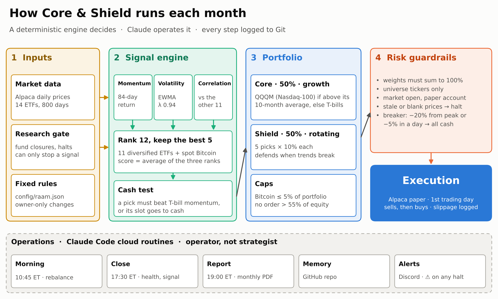

> [!IMPORTANT]
> Research project on an Alpaca **paper** account. Backtested figures are hypothetical, were built with the benefit of hindsight, and include a simulated Bitcoin history before January 2024. Past performance does not predict future results. **Not investment advice.**

---

## Executive summary

| | |
|---|---|
| **What** | Half the portfolio is a fixed 60/40 (**Core**: 30% SPY + 20% AGG). The other half (**Shield**) holds the 5 strongest of 12 diversified ETFs, including spot Bitcoin capped at 5%, and moves to T-bills when nothing is trending. |
| **Objective** | About a 60/40's return, with materially smaller losses in bear markets. It is built to *specialise in defence*, not to beat equities. |
| **Edge, tested** | The ranking beats **97–98%** of 1,000 random-pick portfolios on Sharpe and **97–100%** on down-market defence (2015–2026 and 2008–2026). |
| **Governance** | Deterministic engine, pre-registered evaluation plan, shadow tracking of alternatives, full change log. The AI operates; it never decides. |
| **Status** | Live on Alpaca paper since **1 Oct 2026**. Checkpoints at 1, 3, 6 and 12 months; the verdict is due **Oct 2027**. |

**Key statistics.** Backtest Feb 2015 – Sep 2026 (140 months): 5 bps per trade, next-open fills. T-bills (BIL) returned 2.0%/yr over the window.

| | **Core & Shield** | C&S without Bitcoin | 60/40 | SPY |
|---|---:|---:|---:|---:|
| Return per year | **9.3%** | 6.5% | 9.2% | 14.1% |
| Volatility | **7.8%** | 6.9% | 10.0% | 15.6% |
| Sharpe ratio vs T-bills | **0.93** | 0.66 | 0.73 | 0.81 |
| Sharpe ratio, rf = 0 | 1.18 | 0.95 | 0.93 | 0.93 |
| Worst month-end drawdown | **−11.1%** | −11.1% | −19.2% | −23.3% |
| Worst daily drawdown | −14.1% | −14.6% | — | −33.7% |
| 2022 | **−8.8%** | ≈ −8% | −15.2% | −18.0% |
| Longest time under water | 24 months | 25 months | 24 months | 23 months |
| Beta to 60/40 | 0.69 | 0.65 | 1.00 | — |

Over a longer, harder window **without Bitcoin** (Mar 2008 – Sep 2026, 223 months), Core & Shield returned **6.6%/yr** against 60/40's 8.5%. Its Sharpe was **0.93 vs 0.85**, and its worst month-end drawdown **−19.0% vs −30.2%**. That is the honest base case: a defensive product that gives up some return in bull markets.

---

## Investment thesis

1. **The problem.** A 60/40 is the default balanced portfolio, but its losses arrive together. Stocks and bonds fell at the same time in 2022 (−15.2%), and the 2008–09 drawdown reached −30%.
2. **The trade-off.** Tactical trend-following models sidestep slow bear markets, but they hold defensive assets too often and lag badly in bull markets.
3. **The design.** Combine the two:
   - The **Core** keeps half the money always invested for long-run growth.
   - The **Shield** is a rotation engine that holds what is trending, calm and diversifying, and retreats to T-bills when trends break.
   - Each half covers the other's weakness.
4. **Why the signal should persist.** It rests on some of the best-documented effects in finance:
   - time-series and cross-sectional **momentum** across asset classes, over a century of data;
   - the **low-volatility** effect;
   - **diversification** across low-correlation assets.

   See the references below.
5. **Who it is for.** Investors judged on risk-adjusted return and drawdown rather than maximum return: pension and superannuation funds, income drawers, anyone near a goal date.

**Not designed to:**
- beat the S&P 500;
- avoid a one-day crash (it is monthly);
- be a Bitcoin strategy (one candidate of twelve, capped at 5%).

---

## How it works

**Portfolio = Core + 0.5 × Shield**, rebalanced once a month.

| Half | Weight | Holdings | Rule |
|---|---|---|---|
| **Core** | 50% | SPY 30% · AGG 20% | Fixed; reset every month |
| **Shield** | 50% | 5 slots × 10%, chosen from 12 candidates | Re-ranked every month; failed slots go to BIL (T-bills) |

**Shield candidates** (the 7Twelve multi-asset set plus spot Bitcoin):

| Asset class | ETFs |
|---|---|
| US equities | VV, IJH, IJR |
| International equities | EFA, EEM |
| Real estate | RWR |
| Commodities and resources | DBC, VAW |
| US bonds and inflation-protected | AGG, TIP |
| International government bonds | IGOV |
| Crypto | IBIT, **capped at 5% of the portfolio** |
| Cash (not ranked) | BIL |

**The monthly decision** is computed after the close on the last trading day, and traded at the next morning's session (~10:45 ET):

| Factor | Measure | Best rank goes to |
|---|---|---|
| Momentum | 84-trading-day return | highest |
| Volatility | EWMA (λ = 0.94), annualised, 10-day smoothed | lowest |
| Correlation | average 84-day correlation with the other 11 | lowest |

`Score = ⅓·Rank(M) + ⅓·Rank(V) + ⅓·Rank(C)`. The 5 lowest scores are selected. A selected ETF keeps its 10% slot only if its momentum beats T-bill (BIL) momentum; otherwise the slot goes to BIL. Full rules: [memory/TRADING-STRATEGY.md](memory/TRADING-STRATEGY.md).

---

## A real month, step by step

Each stage has one job and one owner. These are the actual outputs from the first live month: the 30 Sep 2026 signal and the 1 Oct 2026 trades.

### 1 · Research gate
- Claude scans all 14 funds for closures, mergers, ticker or index changes and halts, plus custody and regulatory risks for IBIT.
- A structural flag **stops** the signal and raises a ⚠️ alert. Market news is logged as context and never changes a pick.

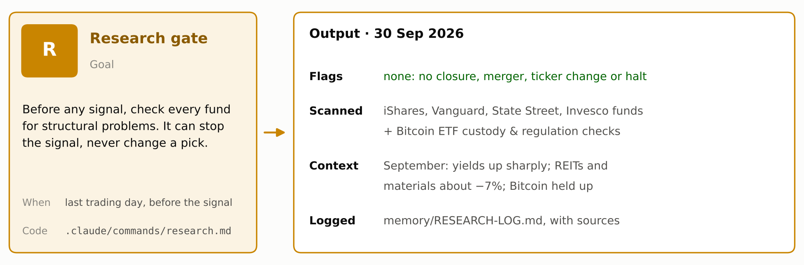

### 2 · Signal engine
- Ranks the 12 candidates on momentum, volatility and correlation, and keeps the best 5.
- Each pick must then beat T-bill momentum. In September, three of the five did not, so their slots went to T-bills: the model turned defensive as designed.

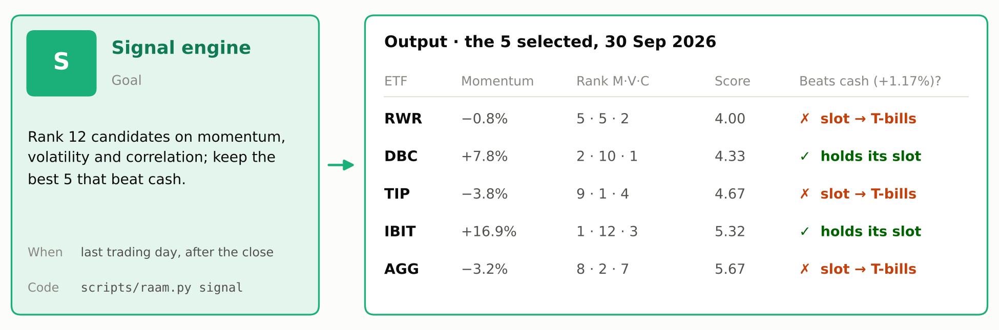

### 3 · Portfolio construction
- Adds the fixed Core to the Shield's picks, then applies the caps.
- IBIT won a full 10% slot, so the 5% cap moved half of it to T-bills.

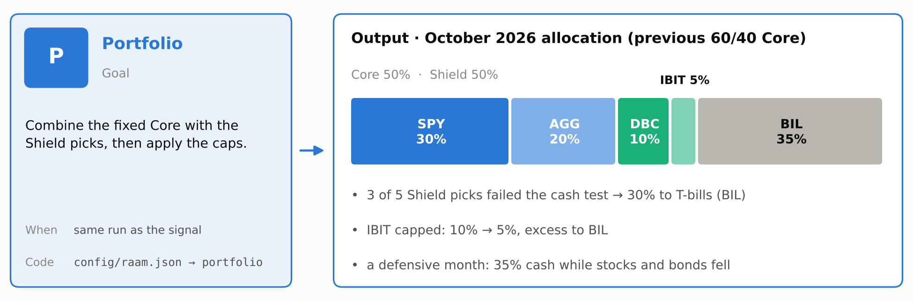

### 4 · Execution
- After the risk checks, orders go to Alpaca at about 10:45 ET on the first trading day: sells first, then buys.
- Every fill is logged with its slippage against the planned price.

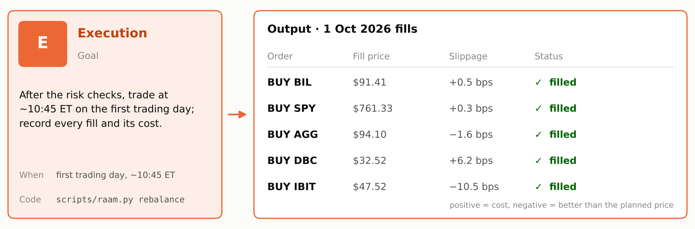

### 5 · Oversight
- Each month is scored against the pre-registered evaluation plan, and every run posts one line to Discord.
- The first review, covering the 30 Sep signal and the 1 Oct rebalance, passed every operations check (O1–O8).

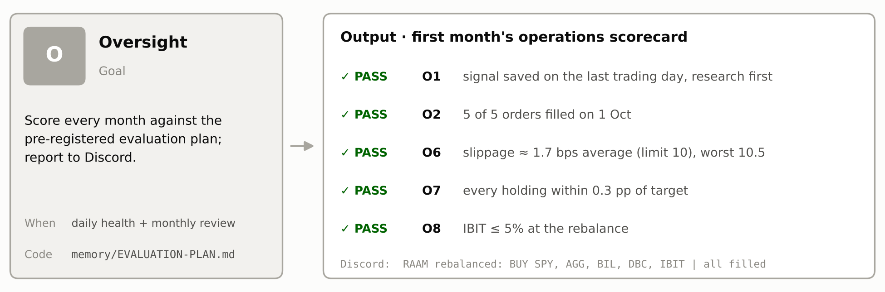

---

## Methodology and assumptions

| Item | Assumption |
|---|---|
| Engine | The backtest calls the live `compute_signal()`: the code that trades is the code that was tested |
| Data | Yahoo Finance daily prices, adjusted for splits and dividends |
| Window | Feb 2015 – Sep 2026, 140 monthly rebalances. Also Mar 2008 – Sep 2026 without Bitcoin (IGOV extended with BWX before 2009) |
| Execution | Signal at the month-end close; fill at the next session's open; held to the next rebalance |
| Costs | 5 bps per side on turnover. No management fee, financing or taxes |
| Bitcoin before 2024 | BTC-USD on US trading days, minus IBIT's 0.25% fee, spliced into real IBIT from its January 2024 launch |
| Circuit breaker | Simulated on the daily path |
| Benchmarks | 60/40 = 60% SPY + 40% AGG, rebalanced monthly; SPY total return |
| Sharpe ratio | Shown both against T-bills (BIL, 2.0%/yr over the window) and at rf = 0 |
| Known biases | Several design choices (dropping the trend factor, the 50/50 split, adding Bitcoin) were made after seeing this data, so there is no clean out-of-sample period. Treat all backtest figures as optimistic; the live paper record is the real test. |

---

## Evidence

### Backtest

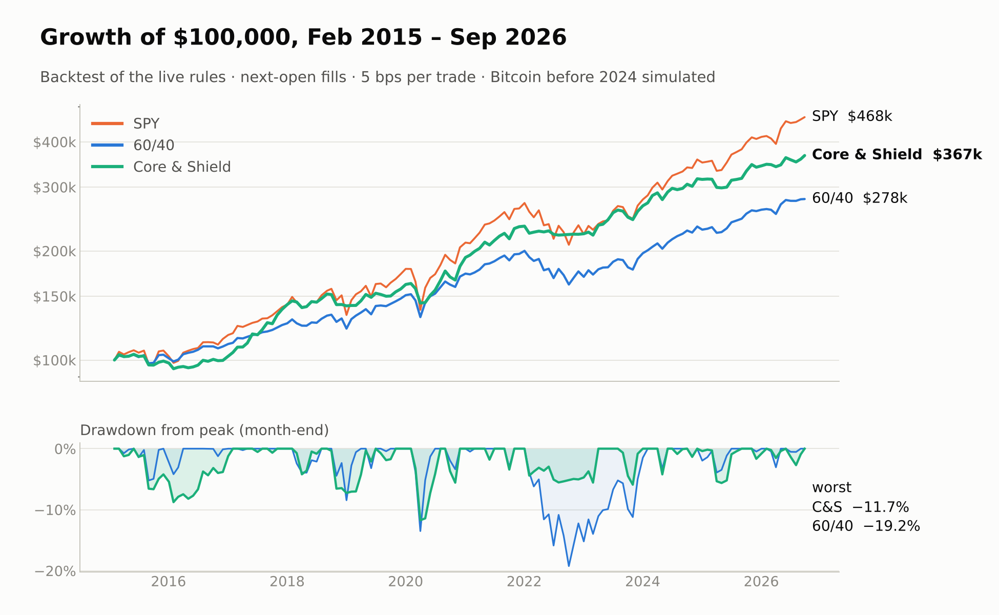

Core & Shield matched 60/40's return with about **22% less volatility** and **42% less maximum drawdown**. It took **63%** of 60/40's losses in 60/40's down months.

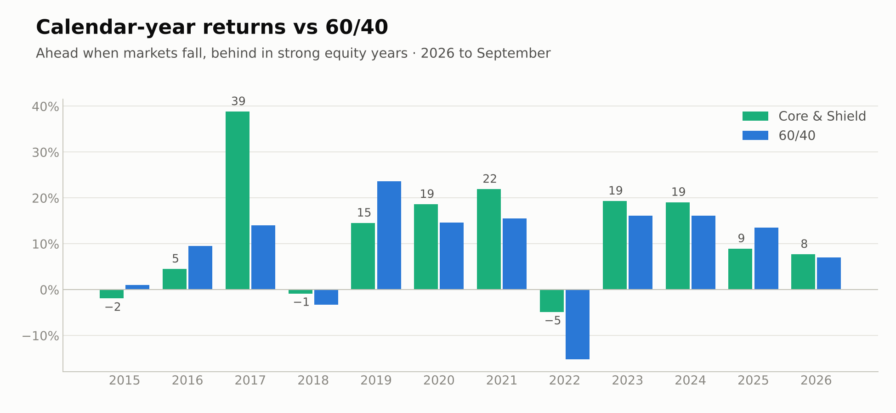

The pattern is the design working:
- **ahead in falling markets**, 2022 most clearly;
- **behind in strong equity years** (2019, 2023–2025);
- 2018 was worse than 60/40 because Bitcoin's crash hit while it was held. Without Bitcoin, 2018 was about level.

### Early vs late period

The design choices used the whole 2015–2026 history, so neither half is truly out of sample. Splitting it still shows whether the result depends on one era:

| | 2015–19 Core & Shield | 2015–19 60/40 | **2020–26 Core & Shield** | **2020–26 60/40** |
|---|---:|---:|---:|---:|
| Return per year | 9.4% | 8.7% | **9.2%** | **9.5%** |
| Sharpe vs T-bills | 1.23 | 1.01 | **0.75** | **0.61** |
| Worst month-end drawdown | −7.1% | −8.4% | **−11.1%** | **−19.2%** |
| Share of 60/40's down-month losses | 65% | — | **63%** | — |
| Without Bitcoin: Sharpe vs T-bills | 0.66 | — | **0.68** | — |

Risk-adjusted performance was weaker in 2020–26 but **stayed ahead of 60/40**. The defence held up: −11% against −19% in 2022. The worst drawdown took 9 months to bottom and 16 to recover, about as long as 60/40's, but at little more than half the depth.

Source: [backtest/results/readme_metrics.json](backtest/results/readme_metrics.json), built by `docs/readme_metrics.py`.

### Is the ranking skill or luck?

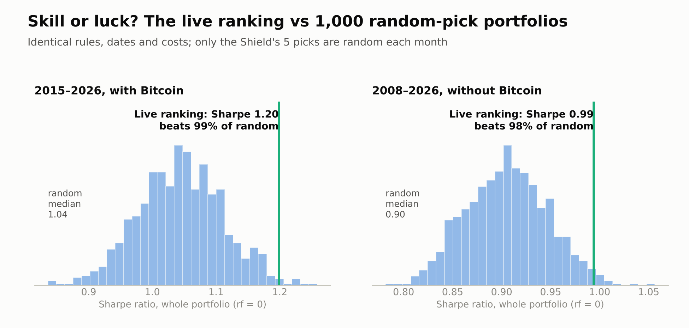

The live ranking was compared with 1,000 portfolios whose Shield holds **5 random candidates** each month, with every other rule identical.

| Test | 2015–26 (with Bitcoin) | 2008–26 (no Bitcoin) |
|---|---:|---:|
| Beats random on Sharpe | **97%** | **98%** |
| Beats random on down-market defence | **97%** | **100%** |
| Beats random on return | 98% | 86% |

**Which parts matter:**
- *Momentum alone* earns more but defends far worse: 83% of 60/40's down-month losses against 63%. The volatility and correlation ranks are what make the Shield defensive.
- The cash test does much of the work.
- The ranking adds defence on top of the cash test.

Source: [backtest/results/ROBUSTNESS.md](backtest/results/ROBUSTNESS.md).

### Stress tests

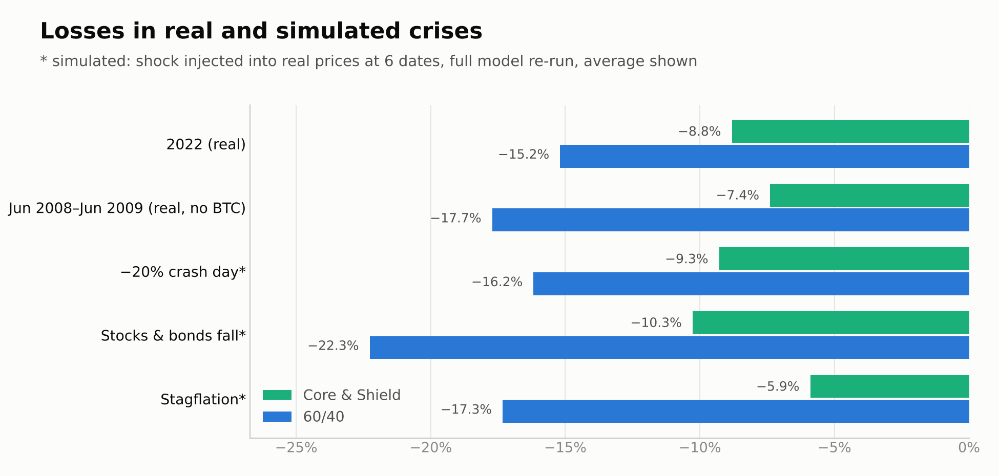

| Question | Finding |
|---|---|
| **Trading costs** | The Sharpe edge over 60/40 survives even 50 bps per trade (0.97 vs ~0.92). The return edge disappears above ~10 bps. |
| **Parameter sensitivity** | **13 of 13** nearby settings (lookbacks 63–126 days, hold 4–6, λ, factor weights ±10 pp) still beat 60/40's Sharpe; the range is 1.03–1.28. It is not a lucky peak. |
| **Late execution** | Filling 2–5 days after the signal barely matters (Sharpe 1.18–1.23). |
| **Any single year** | It beat 60/40 on return in only 49% of rolling 12-month windows, but had the **smaller drawdown in 89%**. |
| **Monte Carlo** | Across 5,000 bootstrapped 10-year paths: **94%** chance of a higher Sharpe than 60/40, **97%** chance of a smaller worst drawdown. |
| **Bitcoin −80% while held** | About −3 pp extra loss, as the 5% cap intends. |
| **Realistic worst case** | About **−20% to −22%**. In 2008–09 the −20% circuit breaker tripped once. |

Source: [backtest/results/STRESS.md](backtest/results/STRESS.md).

### Attribution: where the return comes from

| | Beta to 60/40 | Alpha / yr (rf = T-bills) |
|---|---:|---:|
| Core & Shield | **0.69** | **+2.2%** (t ≈ 2.0) |
| Core & Shield without Bitcoin | 0.65 | −0.2% |

The strategy's main product is **lower market exposure with smaller drawdowns**. Nearly all of the measured alpha comes from timing Bitcoin, which should not be expected to repeat at the same size.

---

## Risk management and governance

| Control | Rule |
|---|---|
| **Circuit breaker** | −20% from the high-water mark, or −5% in one day, moves the whole portfolio to T-bills. It re-enters automatically at the next monthly rebalance. |
| **Data integrity** | Stale, missing, blank or non-positive prices halt the signal. There is no guessing. |
| **Order checks** | Weights must sum to 100% ± 0.5%; universe tickers only; no single buy above 35% of equity; buys are scaled to available cash; the market must be open. |
| **Broker failures** | A rejected or partial order, or an API error mid-rebalance, records what filled, halts, and alerts. It is never retried blindly. |
| **Paper lock** | Live trading needs two explicit switches (`PAPER_TRADING=false` and `LIVE_CONFIRM=yes`). |
| **Pre-registered evaluation** | Pass/fail criteria were written *before* the first trade ([EVALUATION-PLAN.md](memory/EVALUATION-PLAN.md)): operations (O1–O8) and behaviour (B1–B5), with a rules-based 12-month verdict. |
| **Shadow tracking** | Four pre-registered alternatives (no Bitcoin, 50% SPY Core, 40/10 Core, Bitcoin satellite) are tracked monthly without trading ([SHADOW-LOG.md](memory/SHADOW-LOG.md)). This builds live evidence without resetting the test. |
| **Change control** | Rules change only by owner decision, with evidence, in a dated change log. |
| **AI boundaries** | Claude runs the routines, writes the logs and may **halt**. It never changes targets, picks, timing or rules. All maths and orders live in one deterministic script. |
| **Secrets** | API keys live only in the cloud environment's variables, never in files, commits or messages. |

---

## Costs, capacity and taxes

| | |
|---|---|
| **Turnover** | About 15% of the portfolio is replaced each month (3.6× a year, two-sided) |
| **Trading cost in the backtest** | 5 bps per side ≈ 0.18% a year. Still ahead of 60/40 on Sharpe (rf = 0) even at 50 bps per side |
| **Live slippage, first rebalance** | Value-weighted average about 0 bps (range −10.5 to +6.2 bps across 5 orders) |
| **Capacity** | All 14 holdings are liquid US-listed ETFs; one monthly rebalance. Capacity is not a constraint at personal or small-fund scale |
| **Fund fees** | Inside the ETF prices, so included. No management or advisory fee is modelled |
| **Taxes** | Not modelled. Monthly turnover would create short-term gains in a taxable account, so it suits tax-advantaged accounts best |

---

## Live paper trading

| | |
|---|---|
| Account | Alpaca paper, $100,000 starting equity |
| First signal / first trades | 30 Sep 2026 / 1 Oct 2026 (all orders filled) |
| Daily | Health check: equity, drawdown, drift, breaker. One Discord line. |
| Monthly | Signal, rebalance, one-page PDF report, and a review scored against the evaluation plan |
| Where to look | [reports/](reports/) · [memory/SHADOW-LOG.md](memory/SHADOW-LOG.md) · [memory/TRADE-LOG.md](memory/TRADE-LOG.md) · [memory/SIGNAL-LOG.md](memory/SIGNAL-LOG.md) · [memory/MONTHLY-REVIEW.md](memory/MONTHLY-REVIEW.md) |

| Checkpoint | Date | Question |
|---|---|---|
| 1 month | Nov 2026 | Does it run correctly? |
| 3 months | Jan 2027 | Is it reliable? |
| 6 months | Apr 2027 | Does it behave like the backtest? |
| 12 months | Oct 2027 | Is it worth running? |

---

## System architecture

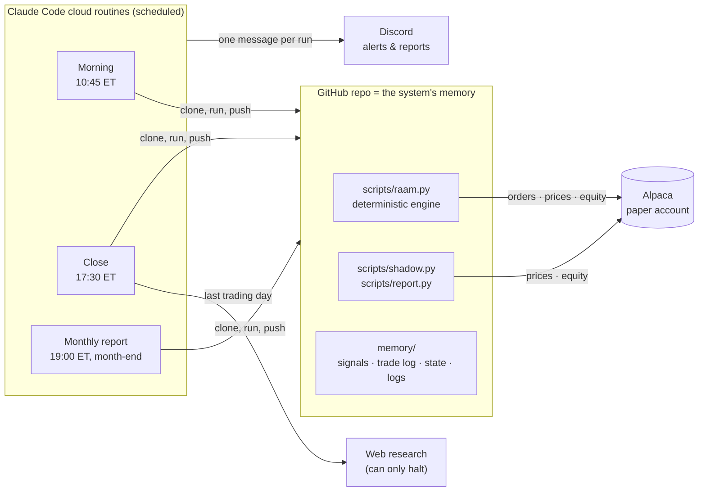

| Routine | Schedule (cron in UTC) | Does |
|---|---|---|
| **Morning** | Weekdays 10:45 EDT / 09:45 EST | Rebalance on the first trading day of the month, or if the breaker tripped. Otherwise does nothing. |
| **Close** | Weekdays 17:30 EDT / 16:30 EST | Daily health; month-end research → signal → shadow variants; first-day monthly review. |
| **Monthly report** | 19:00 EDT / 18:00 EST, days 28–31 | One-page PDF (account vs 60/40) on the last trading day, posted to Discord. |

**Engineering:**
- One deterministic engine: the same data always gives the same targets.
- Every command prints a single JSON object with `ok` / `noop` / `halt` / `error`.
- Dry-run modes everywhere; idempotent rebalances (a month can't be traded twice).
- **76 tests** with no network, including fault drills for broker errors, partial fills and bad data.

---

## Limitations

- **Thin return edge.** Without Bitcoin, the strategy trails 60/40 by about 2%/yr in normal markets. It was ahead in only 5 of 19 calendar years (2008–2026). Its value is defence.
- **Bitcoin dependence.** Most of the measured alpha is Bitcoin timing. Bitcoin history before 2024 is simulated from BTC-USD minus IBIT's fee.
- **Hindsight.** Several design choices were made after seeing 2015–2026 data. With ~11 years, a Sharpe estimate is only accurate to about ±0.3.
- **Monthly cadence.** It can't avoid a one-day crash. The −5% daily breaker can then lock in a loss and miss a fast rebound.
- **Paper, not live.** Paper fills do not capture real market impact. Taxes are ignored, and turnover is about 15% a month.
- **Small universe.** 12 candidates make the ranks lumpy, and there are few true crisis assets (no gold or long Treasuries).

---

<details>
<summary><b>Repository guide</b></summary>

| Path | Purpose |
|---|---|
| `CLAUDE.md` | Operating instructions for the AI operator (rules, safety, standard procedure) |
| `config/raam.json` | Strategy parameters and guardrail thresholds |
| `config/shadow.json` | Pre-registered shadow variants (tracked, never traded) |
| `scripts/raam.py` | Deterministic engine: calendar, signal, rebalance, health, review, pre-flight |
| `scripts/shadow.py` | Shadow tracking of strategy variants |
| `scripts/report.py` | One-page monthly PDF report |
| `scripts/alpaca.sh`, `scripts/discord.sh` | Broker and notification helpers |
| `.claude/commands/` | Operator commands: `/signal` `/rebalance` `/health` `/monthly-review` `/report` `/research` `/portfolio` `/trade` |
| `routines/` | Paste-ready prompts for the cloud routines |
| `memory/` | Rules, evaluation plan, backtest summary, logs, signals, state |
| `backtest/` | Backtest (`backtest.py`), stress tests (`stress.py`), robustness tests (`robustness.py`) and results |
| `docs/` | Strategy handbook PDF, README image builder |
| `reports/` | Monthly PDF reports |
| `tests/` | pytest suite (engine, commands, faults, report, shadow) |

</details>

<details>
<summary><b>Quickstart (local)</b></summary>

```bash
python -m pip install -r requirements.txt
cp env.template .env                                # Alpaca paper keys, Discord webhook
python -m pytest -q                                  # 76 tests, no network
python scripts/raam.py calendar
python scripts/raam.py signal --force --dry-run      # today's ranks, nothing saved
python scripts/raam.py rebalance --force --dry-run   # the orders it would place
python backtest/backtest.py                          # rebuild the backtest report
python docs/readme_metrics.py                        # rebuild the README's extra figures
python docs/build_readme_assets.py                   # rebuild the README images
```

</details>

<details>
<summary><b>Cloud routine setup</b></summary>

1. **Cloud environment** (claude.ai/code → environments):
   - **Environment variables:** everything in `env.template`, with real values. Keep `PAPER_TRADING=true`. Routines read keys only from here; the scripts never read `.env` in the cloud.
   - **Network:** custom. Allow `paper-api.alpaca.markets`, `data.alpaca.markets` and `discord.com`, plus default package managers.
   - **Setup script:** `python3 -m pip install -r requirements.txt`
2. **Routines:**
   - repo `musu-codes/RAAM-Trading-Project`;
   - the environment above;
   - no connectors;
   - prompts and crons from [routines/](routines/).
3. **First runs:** *Run now* with `dry_run`, and read the transcript. A green status only means it didn't crash.

</details>

---

## Documentation

- **[Strategy handbook (PDF)](docs/Core-and-Shield-Strategy.pdf):** the full strategy in 12 pages.
- [Trading rules](memory/TRADING-STRATEGY.md) · [Evaluation plan](memory/EVALUATION-PLAN.md) · [Backtest summary](memory/BACKTEST-SUMMARY.md)
- Results: [backtest report](backtest/results/REPORT.md) · [stress tests](backtest/results/STRESS.md) · [robustness](backtest/results/ROBUSTNESS.md)

## References

- Giordano, G. (2018). *Ranked Asset Allocation Model.* Charles H. Dow Award, CMT Association. The origin of the Shield.
- Moskowitz, T., Ooi, Y. H. & Pedersen, L. H. (2012). Time series momentum. *Journal of Financial Economics.*
- Asness, C., Moskowitz, T. & Pedersen, L. H. (2013). Value and momentum everywhere. *Journal of Finance.*
- Hurst, B., Ooi, Y. H. & Pedersen, L. H. (2017). A century of evidence on trend-following investing. *Journal of Portfolio Management.*
- Faber, M. (2007). A quantitative approach to tactical asset allocation. *Journal of Wealth Management.*
- Frazzini, A. & Pedersen, L. H. (2014). Betting against beta. *Journal of Financial Economics.*
- Israelsen, C. (2010). *7Twelve: A Diversified Investment Portfolio with a Plan.* Wiley.

<sub>Paper-trading research project. All backtested results are hypothetical, and simulated performance has inherent limitations. Nothing here is investment, financial or trading advice.</sub>
