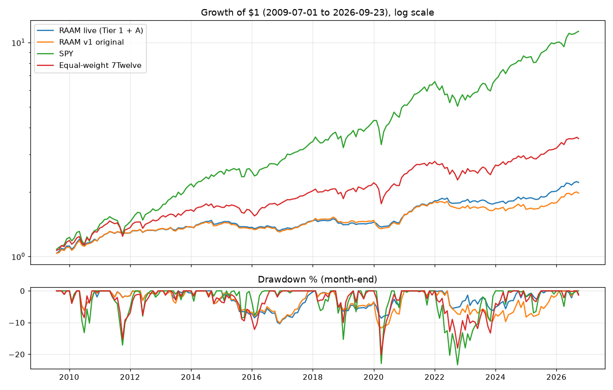

# RAAM Backtest Report

Generated 2026-09-23 by `backtest/backtest.py`. Costs: 5 bps per side on turnover.
Engine: the live `scripts/raam.py compute_signal()` with `config/raam.json` (**Tier 1: BIL cash, cash-momentum hurdle, −20% breaker with auto re-entry; improvement A: trend term off**).
Signal at the month-end close, fill at the next open. The breaker is simulated on the daily path.
Data: Yahoo Finance adjusted daily OHLC. Past results do not guarantee future results.

## 1. Headline: Scenario A, real data only (2009-07-01 → 2026-09-23)
| Variant | CAGR % | Vol % | Sharpe | MaxDD % (monthly) | Worst month % | Down capture % | Up capture % | Months |
|---|---|---|---|---|---|---|---|---|
| RAAM live (Tier 1 + A) — full | 4.72 | 5.74 | 0.83 | -10.39 | -4.68 | 24.27 | 28.11 | 207 |
| RAAM live (Tier 1 + A) — 2009-2019 | 3.59 | 5.54 | 0.66 | -10.39 | -4.68 | 26.25 | 25.40 | 126 |
| RAAM live (Tier 1 + A) — 2020-now | 6.52 | 6.05 | 1.08 | -6.19 | -4.45 | 22.09 | 31.59 | 81 |
| RAAM v1 original — full | 4.03 | 6.30 | 0.66 | -11.77 | -5.41 | 31.70 | 29.35 | 207 |
| RAAM v1 original — 2009-2019 | 3.77 | 5.66 | 0.68 | -10.17 | -4.68 | 27.30 | 26.57 | 126 |
| RAAM v1 original — 2020-now | 4.43 | 7.21 | 0.64 | -9.71 | -5.41 | 36.54 | 32.90 | 81 |
| SPY — full | 15.08 | 14.79 | 1.03 | -23.31 | -16.35 |  |  | 207 |
| SPY — 2009-2019 | 14.96 | 13.05 | 1.14 | -17.10 | -11.73 |  |  | 126 |
| SPY — 2020-now | 15.27 | 17.22 | 0.92 | -23.31 | -16.35 |  |  | 81 |
| Equal-weight 7Twelve — full | 7.64 | 10.76 | 0.74 | -20.18 | -14.34 | 69.82 | 60.46 | 207 |
| Equal-weight 7Twelve — 2009-2019 | 7.85 | 9.74 | 0.83 | -15.27 | -9.27 | 71.80 | 61.79 | 126 |
| Equal-weight 7Twelve — 2020-now | 7.31 | 12.25 | 0.64 | -18.25 | -14.34 | 67.65 | 58.74 | 81 |

The Sharpe uses rf = 0.
- **Down capture:** the average RAAM return in SPY's down months, as a % of SPY's loss. Lower is better defence.
- **Up capture:** the same, for SPY's up months.

**Live config, daily path:**
- Max drawdown **-12.0%** on 2020-03-18. SPY's max drawdown over the same span was -33.7%.
- Worst day **-2.8%**.
- Breaker trips: **0** 

## 2. Pre-registered variants (Scenario A, full period)
| Variant | CAGR % | Vol % | Sharpe | MaxDD % (daily) | Down capture % | Up capture % | Turnover/yr | Avg cash % | Breaker trips |
|---|---|---|---|---|---|---|---|---|---|
| v1 original (SHY, 0% hurdle, trend on, no breaker) | 4.03 | 6.30 | 0.66 | -15.34 | 31.70 | 29.35 | 7.67 | 22.71 | 0 |
| Tier 1 (BIL + cash hurdle + breaker), trend on | 4.07 | 6.19 | 0.68 | -16.15 | 30.32 | 28.81 | 7.78 | 25.31 | 0 |
| Tier 1, trend on, breaker -15% | 3.84 | 6.31 | 0.63 | -16.39 | 31.93 | 28.81 | 7.80 | 25.31 | 1 |
| **LIVE: Tier 1 + trend filter off (A)** | 4.72 | 5.74 | 0.83 | -12.00 | 24.27 | 28.11 | 7.11 | 27.44 | 0 |
| Live + A3 lower band literal, trend on | 4.60 | 5.79 | 0.81 | -12.00 | 24.48 | 27.79 | 7.25 | 27.34 | 0 |
| Live + momentum-heavy 50/25/25 | 5.87 | 7.76 | 0.78 | -15.16 | 37.14 | 38.41 | 7.99 | 18.84 | 0 |
| Live + SHY as cash | 4.62 | 5.73 | 0.82 | -13.02 | 24.59 | 27.89 | 7.02 | 27.54 | 0 |

### The same variants, out-of-sample only (2020 → now)
| Variant | CAGR % | Vol % | Sharpe | MaxDD % (monthly) | Down capture % | Up capture % |
|---|---|---|---|---|---|---|
| v1 original (SHY, 0% hurdle, trend on, no breaker) | 4.43 | 7.21 | 0.64 | -9.71 | 36.54 | 32.90 |
| Tier 1 (BIL + cash hurdle + breaker), trend on | 4.80 | 7.00 | 0.71 | -7.46 | 32.45 | 31.89 |
| Tier 1, trend on, breaker -15% | 4.21 | 7.27 | 0.60 | -7.46 | 35.83 | 31.88 |
| **LIVE: Tier 1 + trend filter off (A)** | 6.52 | 6.05 | 1.08 | -6.19 | 22.09 | 31.59 |
| Live + A3 lower band literal, trend on | 6.32 | 6.07 | 1.04 | -6.83 | 22.51 | 31.22 |
| Live + momentum-heavy 50/25/25 | 6.77 | 7.87 | 0.87 | -9.60 | 31.05 | 37.23 |
| Live + SHY as cash | 5.58 | 6.13 | 0.92 | -9.94 | 25.26 | 30.42 |

## 3. 2008 stress test: Scenario B, with IGOV spliced from BWX (entries Jun-2008 → Jun-2009)
| Variant | CAGR % | Vol % | MaxDD % (monthly) | Worst month % | Total % | Months |
|---|---|---|---|---|---|---|
| RAAM live (Tier 1 + A) | 1.48 | 9.91 | -9.63 | -3.36 | 1.60 | 13 |
| RAAM v1 original | 3.54 | 9.59 | -7.33 | -3.25 | 3.84 | 13 |
| SPY | -29.80 | 31.15 | -43.45 | -16.04 | -31.84 | 13 |
| Equal-weight 7Twelve | -22.44 | 28.54 | -37.43 | -16.35 | -24.07 | 13 |

Scenario B live-config breaker trips: none.

## 4. Calendar years (Scenario A)
| Year | RAAM live % | RAAM v1 % | SPY % | EW 7Twelve % | Live avg cash % |
|---|---|---|---|---|---|
| 2009 | 12.0 | 10.5 | 22.9 | 18.9 | 0 |
| 2010 | 9.7 | 11.4 | 15.0 | 14.3 | 13 |
| 2011 | 4.9 | 4.9 | 2.9 | 0.4 | 30 |
| 2012 | 4.4 | 4.5 | 16.1 | 11.9 | 13 |
| 2013 | 2.0 | 2.2 | 29.3 | 8.3 | 40 |
| 2014 | 5.0 | 3.2 | 14.4 | 2.8 | 15 |
| 2015 | -5.1 | -4.9 | -0.8 | -5.9 | 47 |
| 2016 | -2.0 | -2.2 | 14.7 | 12.1 | 22 |
| 2017 | 9.6 | 11.0 | 21.3 | 13.3 | 15 |
| 2018 | -4.4 | -2.0 | -6.4 | -8.2 | 50 |
| 2019 | 3.0 | 2.6 | 34.0 | 18.6 | 15 |
| 2020 | 8.0 | 6.9 | 18.2 | 9.8 | 28 |
| 2021 | 16.6 | 14.6 | 28.6 | 14.7 | 18 |
| 2022 | -0.3 | -6.6 | -18.0 | -12.3 | 73 |
| 2023 | -2.2 | -0.6 | 24.7 | 9.6 | 37 |
| 2024 | 4.6 | -1.0 | 26.4 | 6.9 | 15 |
| 2025 | 8.7 | 7.4 | 17.7 | 12.5 | 17 |
| 2026 | 9.6 | 10.8 | 12.8 | 10.7 | 33 |

## 5. How often each ETF was held, live config (% of months)
TIP 64.7% · AGG 64.3% · BIL 61.4% · IGOV 44% · RWR 43% · DBC 39.1% · VV 31.4% · IJR 21.7% · EFA 15% · VAW 14.5% · EEM 13.5% · IJH 11.6%

